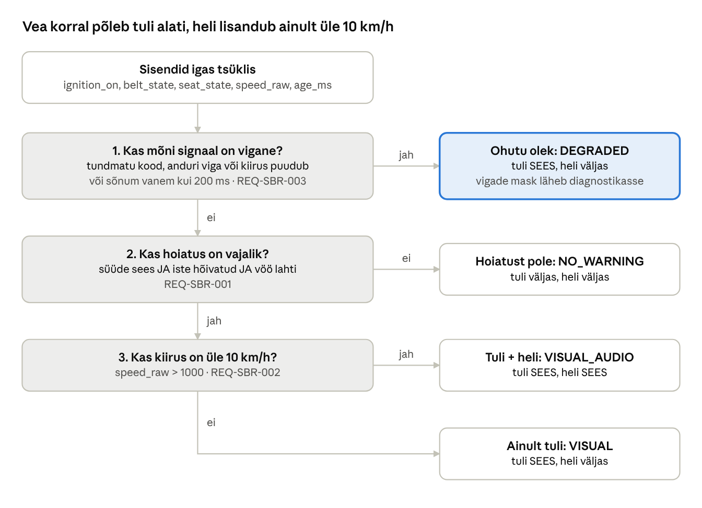

# Turvavöö hoiatussüsteem (Seat Belt Reminder, SBR) C-keeles

Kursusetöö: turvavöö hoiatussüsteem C-keeles, mis järgib standardeid MISRA C, AUTOSAR ja ISO 26262.
Moodul otsustab igas tsüklis, kas süttib turvavöö märgutuli ja kas kõlab helisignaal.

- **Täielik selgitus koos koodi läbivaatusega:** [docs/SELGITUS.md](docs/SELGITUS.md)
- **Sama PDF-ina:** [docs/Turvavoo_hoiatussusteem.pdf](docs/Turvavoo_hoiatussusteem.pdf)
- **Tulemus:** 34/34 testi läbitud, 100% rea- ja harukatvus, MISRA-kontroll (cppcheck) 0 leidu



## Failid

| Fail | Sisu |
|---|---|
| `Sbr.h` | Mooduli liides: sisendite kodeering, tüübid, funktsioon `Sbr_Evaluate()` |
| `Sbr.c` | Hoiatusloogika |
| `Sbr_Cfg.h` | Kalibreeritavad väärtused (10 km/h lävi, 200 ms ajalimiit jne) |
| `Std_Types.h` | AUTOSAR-stiilis põhitüübid (`uint8`, `boolean`, `Std_ReturnType`, `E_OK`) |
| `test_Sbr.c` | Ühiktestid |
| `Makefile` | `make test`, `make coverage`, `make misra` |
| `.vscode/` | VS Code'i seadistus: Ctrl+Shift+B kompileerib ja käivitab, F5 silub |
| `docs/` | Selgitav dokument (Markdown ja PDF) ja otsustusloogika joonis |

## Sisendid

| Sisend | Tüüp | Kehtivad väärtused | Viga |
|---|---|---|---|
| `ignition_on` | `uint8` | 0 = väljas, 1 = sees | iga muu väärtus |
| `belt_state` | `uint8` | 0 = kinnitamata, 1 = kinnitatud | 2 = anduri viga, iga muu väärtus |
| `seat_state` | `uint8` | 0 = tühi, 1 = hõivatud | 2 = anduri viga, iga muu väärtus |
| `speed_raw` | `uint16` | 0…30000 (1 bit = 0,01 km/h → 0…300 km/h) | 0xFFFF = puudub, > 30000 = ebausutav |
| `age_ms` | `uint32` | 0…200 ms | > 200 ms = aegunud |

## Väljund

`visual_on` (märgutuli), `audio_on` (helisignaal), `state` (olek) ja `faults`
(vigade bitimask diagnostika jaoks).

## Loogika (prioriteedi järjekorras)

1. **Reegel 3.** Kui mõni signaal on vigane või sõnum on vanem kui 200 ms →
   **visuaalne hoiatus SEES**, heli VÄLJAS (ohutu olek, `SBR_STATE_DEGRADED`).
2. **Reegel 1.** Kui süüde on sees, iste hõivatud ja vöö kinnitamata → hoiatus:
   - **Reegel 2.** alati visuaalne; kui kiirus > 10 km/h, lisandub heli.
3. Muul juhul hoiatust pole.

```c
Sbr_InputType  in  = { SBR_IGN_ON, SBR_BELT_UNBUCKLED, SBR_SEAT_OCCUPIED,
                       1500U /* 15 km/h */, 20U /* ms */ };
Sbr_OutputType out;

if (Sbr_Evaluate(&in, &out) == E_OK)
{
    /* out.visual_on == TRUE, out.audio_on == TRUE */
}
```

## Rakendatud standardid ja soovitused

### MISRA C:2012 (keele alamhulk ohutuskriitilisele koodile)

- Fikseeritud laiusega tüübid (`uint8`, `uint16`, `uint32`), mitte `int`/`char` (Dir 4.6).
- Märgita konstantidel `U` sufiks (7.2), `boolean` on päris tõeväärtustüüp (`_Bool`) (14.4, 10.1).
- Igal `if`/`else`/`switch` harul looksulud (15.6), iga `if … else if` ahel lõpeb `else`-ga (15.7).
- Igal `switch`-il on `default` viimase harena (16.4, 16.5), iga haru lõpeb `break`-iga (16.3).
- Igal funktsioonil üks väljumispunkt (15.5).
- Kõik muutujad algväärtustatud enne kasutamist (9.1).
- Sisemised funktsioonid `static` ja prototüübiga (8.2, 8.4, 8.8).
- Viidad, mida ei muudeta, on `const` (8.13).
- Puuduvad dünaamiline mälu (21.3), rekursioon (17.2), `stdio.h` (21.6), ujukomaarvud.
- "Maagilised arvud" on nimega makrodena `Sbr_Cfg.h`-s.

**Kontroll:** `cppcheck --addon=misra` → **0 leidu**.
Ametlikud reeglite tekstid on litsentsitud, seega cppcheck näitab ainult reegli
numbrit. cppcheck ei kata kõiki MISRA reegleid; tööstuses kasutatakse
sertifitseeritud tööriistu (nt Polyspace, PC-lint, LDRA).

### AUTOSAR

- Platvormi- ja standardtüübid: `uint8`, `boolean`, `Std_ReturnType`, `E_OK`/`E_NOT_OK`, `NULL_PTR`.
- Mooduli eesliide kõigil nimedel (`Sbr_`, `SBR_`).
- Konfiguratsioon eraldi failis (`Sbr_Cfg.h`), loogika failis `Sbr.c`.
- API kontrollib `NULL_PTR` argumente ja tagastab `E_NOT_OK`.
- Signaali "invalid value" kontseptsioon (0xFF / 0xFFFF = signaal puudub), nagu AUTOSAR COM-is.
- Sõnumi vanuse kontroll (200 ms) vastab AUTOSAR E2E värskuse/ajalimiidi kontrolli ideele.

### ISO 26262 (funktsionaalne ohutus, osa 6: tarkvara)

- **Ohutu olek** on määratud: visuaalne hoiatus sees, heli väljas. Sinna minnakse iga vea korral,
  ka siis, kui `input == NULL_PTR` või olekuväärtus on rikutud (`default` haru).
- **Vigade tuvastus:** iga sisendi vahemiku kontroll + ajalimiit + vigade bitimask diagnostikaks.
- **Ühiku disaini põhimõtted (Tabel 6):** üks sisend/väljund, globaalseid muutujaid pole,
  dünaamilisi objekte ja rekursiooni pole, kaudseid tüübiteisendusi pole.
- **Jälgitavus:** nõuded `REQ-SBR-001…003` on märgitud koodis ja igal testil.
- **Ühiku testimine (Tabelid 7–9):**
  - nõuetepõhised testid, sh piirväärtused (9,99 / 10,00 / 10,01 km/h; 200 / 201 ms);
  - liidese ja vigade sisestamise testid (vigased koodid, `NULL_PTR`);
  - *back-to-back* test: ~170 miljonit sisendikombinatsiooni (kõik 256³ süüte/vöö/istme koodid
    ja kõik 65 536 kiiruse väärtust) võrreldakse eraldi kirjutatud referentsmudeliga;
  - katvus: **100% ridadest ja 100% harudest** (gcov). MC/DC katvust ei mõõdetud.

## Eeldused ja disainiotsused

- **ASIL:** eeldame QM/ASIL A (turvavöö meeldetuletus ei juhi sõidukit). Kõrgema ASIL-i korral
  lisanduksid nt E2E CRC, sõnumiloendur ja riistvaraline jälgimine.
- **"Üle 10 km/h"** tähendab rangelt suurem kui 10,00 km/h (10,00 → ainult visuaalne).
- **"Vanem kui 200 ms"** tähendab > 200 ms (täpselt 200 ms on veel kehtiv).
- **Veaolekus heli puudub**, sest vigaste andmete põhjal ei saa hoiatuse tingimusi kinnitada
  (reegel 3 nõuab ainult visuaalset). Seda saab muuta failis `Sbr.c` (`Sbr_SelectState`).
- **Kommentaarid on eesti keeles** (UTF-8). Programmi väljundtekstid on inglise keeles, et
  tabeli joondus ei nihkuks täpitähtede tõttu.
- **Reegel 3 on kõrgeima prioriteediga**, ka siis, kui süüde on väljas (sõnastuse järgi:
  "kui mõni signaal on vigane").

## Käivitamine VS Code'is

1. Paigalda C-kompilaator:
   - **Windows:** [MSYS2](https://www.msys2.org/), seejärel MSYS2 UCRT64 terminalis
     `pacman -S --needed mingw-w64-ucrt-x86_64-gcc mingw-w64-ucrt-x86_64-gdb`
     ja lisa `C:\msys64\ucrt64\bin` Windowsi PATH-i.
   - **Mac:** terminalis `xcode-select --install`.
   - **Linux (Ubuntu):** `sudo apt install build-essential gdb`.
2. Paigalda VS Code'i laiendus **C/C++** (Microsoft).
3. Laadi kood alla (**Code → Download ZIP** või `git clone`) ja ava kaust VS Code'is: **File → Open Folder**.
4. Vajuta **Ctrl+Shift+B** (Macis Cmd+Shift+B): kood kompileeritakse ja testid käivituvad terminalis.
5. Silumiseks pane murdepunkt (kliki rea numbri ees) ja vajuta **F5**.

Ära kasuta nuppu "Run C/C++ File" (▷): see kompileerib ainult avatud faili ja annab vea
`undefined reference to Sbr_Evaluate`. Programm vajab mõlemat faili: `Sbr.c` ja `test_Sbr.c`.

Ilma VS Code'i seadistuseta, terminalis:

```sh
gcc -std=c99 -Wall -Wextra -o test_Sbr Sbr.c test_Sbr.c
./test_Sbr          # Windowsis: .\test_Sbr.exe
```

## Kompileerimine ja testimine

```sh
make test       # range hoiatustega (-Wall -Wextra -Wconversion ... -Werror) + testid
make coverage   # rea- ja harukatvus (gcov)
make misra      # MISRA C:2012 kontroll (cppcheck)
make clean
```

Tulemus:

```
Summary: 34 checks, 0 failed -> ALL PASSED
Lines executed:100.00% of 73,  Branches: 100.00% of 30
MISRA: no findings
```
